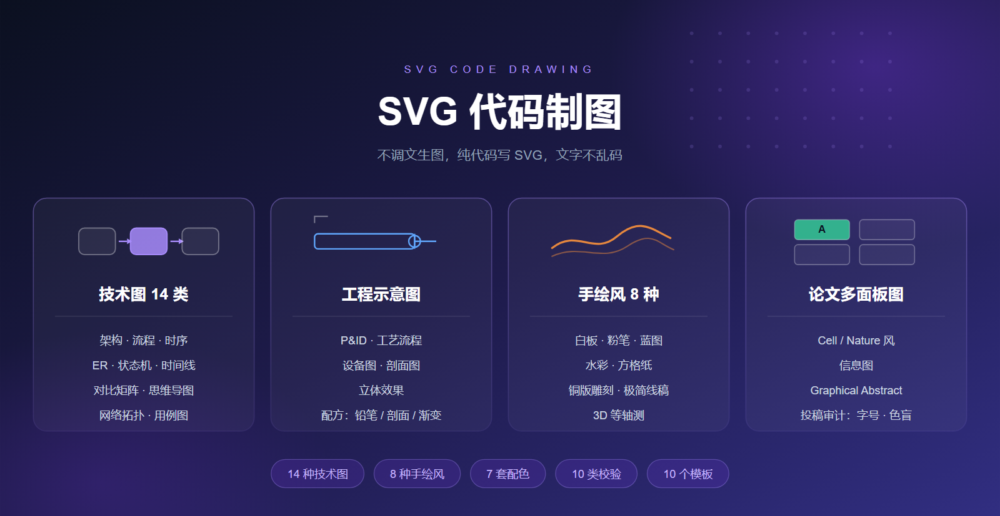
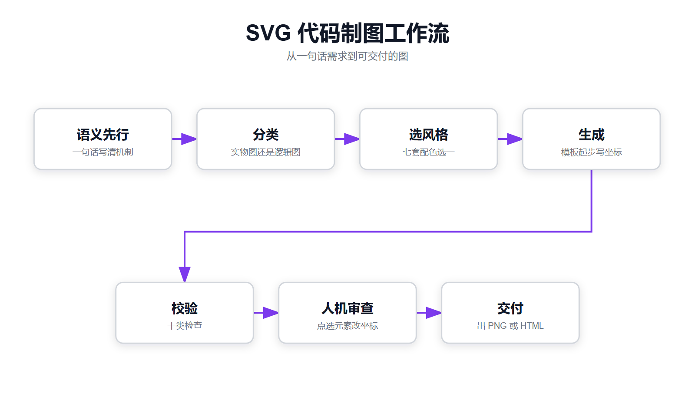

<div align="center">

<div style="max-width:860px;margin:0 auto;padding:32px 26px;border-radius:16px;background:linear-gradient(160deg,#1e1b4b 0%,#312e81 48%,#4c1d95 100%);box-shadow:0 12px 32px rgba(30,27,75,.28);">

<div style="font-size:.76em;letter-spacing:5px;color:#a78bfa;text-transform:uppercase;">SVG Code Drawing</div>

<h1 style="margin:12px 0 8px 0;font-size:2em;font-weight:700;color:#ffffff;border:none;line-height:1.3;">SVG 代码制图</h1>

<div style="font-size:.95em;color:#e0e7ff;line-height:1.8;font-weight:300;">不调文生图，<strong>纯代码写 SVG</strong>。文字用系统字体直排，中英混排字体分开指定，结构坐标逐点计算，文字不乱码</div>

</div>

</div>

<p align="center">

</p>

<p align="center">
<sub>目录　<a href="#安装">安装</a>　·　<a href="#能画什么">能画什么</a>　·　<a href="#何时用">何时用</a>　·　<a href="#怎么工作">怎么工作</a>　·　<a href="#字体">字体</a>　·　<a href="#目录结构">目录结构</a>　·　<a href="#宣传物料">宣传物料</a></sub>
</p>

---

## 安装

本仓是 [Agent Plugins 1.0.0](https://agent-plugins.org/specification) 标准包：根有 `plugin.json`，skill 本体在 `skills/svg-code-drawing/`。

支持该规范的客户端直接添加本仓地址即可。不支持的客户端，把 `skills/svg-code-drawing/` 整个目录拷进 skill 目录（Cherry Studio 的 skill 根目录是 `Data/Skills`）。

## 能画什么

| 路线 | 覆盖范围 |
|:--|:--|
| **技术逻辑图** | 架构、流程、时序、ER、类图、状态机、时间线、甘特、对比矩阵、思维导图、用例、网络拓扑、Agent 架构、记忆架构，共 14 类型 |
| **工程示意图** | P&ID、设备图、工艺流程、剖面、立体效果。三套配方：铅笔、剖面、渐变 |
| **手绘风** | 白板马克笔、黑板粉笔、蓝图、钢笔淡彩、方格纸、铜版雕刻、极简线稿、3D 等轴测，共 8 种 |
| **论文多面板图** | Cell / Nature 风版面、信息图、Graphical Abstract（图形摘要），附投稿审计（字号 pt、色数、色盲、统计口径） |
| **信息图** | 一页一个数据故事：大数字、比例条、刻度、结论、来源；一份 JSON 生成 1536×864 SVG，叠纸面底图 |

技术图另有七套配色（style-1 到 style-7，默认 style-1），按图型选型见 `references/style-diagram-matrix.md`。

## 何时用

- 要画架构图、流程图、时序图、ER 图、UML、状态机、时间线、矩阵、思维导图、网络拓扑
- 要画工程图：P&ID、设备图、工艺流程、剖面、立体效果
- 要手绘风：白板、粉笔、蓝图、水彩、方格纸、铜版雕刻、极简线稿、3D 等轴测
- 要论文配图：Cell / Nature 风多面板图、信息图、Graphical Abstract
- 要做一页一个数据故事的信息图：大数字、比例条、刻度、结论，不要三栏卡片仪表盘
- 触发词：画图、示意图、架构图、流程图、P&ID、论文配图、信息图、手绘风、SVG

## 怎么工作

<p align="center">

</p>

0. **语义先行**：一句话写清这张图要传达的机制。每个形状对应一个能命名的真实概念，叫不出名字的删掉。节点上限 9，超过拆成两张图。
1. **分类**：实物、设备、P&ID、剖面走工程示意图；逻辑、架构、流程走技术逻辑图。
2. **选风格与字体**：工程图用三套配方；手绘风八选一；技术图默认 style-1。字体按需指定，写名字前先查（见下节）。
3. **生成**：技术图用 `build_diagram.py` 起步（生成、校验、导出一条命令），信息图先写 JSON 规格再用 `build_infographic.py` 出 SVG，工程图写 Python 脚本，有现成稿走导入器（Mermaid、draw.io）。
4. **校验**：十类检查。目标为 PPT、打印、HMI 时加 `--portable`。
5. **人机审查**：同一台机器时产物打成 HTML 壳，浏览器里点选元素，改坐标再合成，刷新复查；浏览器不在同一台机器时改用 `annotate_html.py` 生成单文件标注页，用户框选/点选后导出 JSON。
6. **交付**：出 PNG（resvg / rsvg-convert / Chromium 自动降级），保留原 SVG 与 HTML。

## 字体

中文和英文分开指定，生成器传 `font_en` 与 `font_cn`：

```json
{"font_en": "Georgia", "font_cn": "宋体"}
```

输出 `font-family: 'Georgia', '宋体', sans-serif`：英文、数字走 Georgia，中文走宋体。SVG 根元素自动带 `xml:lang="zh-CN"`，多语言字体按简中字形渲染。

写字体名前先跑 `scripts/check_font.py` 查一遍，避开两类坑：

- **.ttc 集合取错变体**：Noto Sans CJK、Source Han Sans 这类集合一个文件含简中、繁中、日文、韩文、香港五个变体，裸名字按索引 0 取，而索引 0 常是日文。修法是写带地区后缀的精确名 `'Noto Sans CJK SC'`。
- **未装字体静默回退**：名字不存在时渲染器回退到默认字体，某些系统默认 CJK 字体是日文字体，同样出日文字形。

```bash
uv run --with fonttools python skills/svg-code-drawing/scripts/check_font.py --check "宋体" "Noto Sans CJK"
uv run --with fonttools python skills/svg-code-drawing/scripts/check_font.py --stack --cn 微软雅黑 --en "Segoe UI"
```

`--check` 会点名未安装的字体、标出多语言集合并给出精确名建议；`--stack` 直接生成中英混排字体栈。细节见 `skills/svg-code-drawing/references/fonts.md`。

## 目录结构

```
plugin.json                     Agent Plugins 1.0.0 manifest
skills/svg-code-drawing/        skill 本体
  SKILL.md                      主文档：路线图、工作流六步、路线判定、响应契约、文件清单
  references/                   各路线详解与配色
    fonts.md                    字体：中英混排与 .ttc 集合规避
    engineering-three-styles.md 工程图三套配方：E1 铅笔、E2 剖面、E3 渐变
    hand-drawn-styles.md        手绘风八种
    diagram-types.md            技术图 14 类型
    academic/                   期刊版面规格、图注工作流、组件库
    style-1..7*.md              技术图配色，默认 style-1
    layout-arithmetic.md        布局尺寸算术：居中、基线、盒高、连接线、交付自查
    annotation-review.md        读图评审：单文件标注页、JSON 坐标回改
    infographic.md              信息图：数据规格、纸面底图、合成与标注
    pitfalls.md                 生成方式、导入器、防错、坑速查、可移植模式
    svg-beyond-drawing.md       动画、交互、图表、地图、图标 sprite
    icons.md                    产品图标
  scripts/                      生成器与工具
    generate_three_styles.py    工程图三件套
    generate-from-template.py   技术图 14 类型生成器，支持 font_en/font_cn 中英混排
    build_diagram.py            生成、校验、导出 PNG 一条命令
    build_infographic.py        信息图生成器：JSON 规格 → SVG
    check_font.py               字体名解析、.ttc 多语言集合检测、中英混排字体栈
    validate_svg.py             校验 10 类检查，--portable 面向 PPT/打印/HMI
    export_png.py               出 PNG（resvg-py / rsvg-convert / cairosvg / Chromium 自动降级）
    bundle_html.py              打 HTML 交付壳（响应式缩放、内联 DOM 可点选）
    academic_figure.py          期刊骨架生成（mm 坐标 + 变体）
    example_cell_figure.py      Cell 风成品范例
    audit_figure.py             投稿审计：字号 pt、色数、色盲、统计口径
    mermaid_to_svg.py           导入 Mermaid
    drawio_to_svg.py            导入 draw.io
    extract_brand.py            站点品牌色提取
    compose_layers.py           画风质感管线：底图 + 配件 + 线稿三层合成（水印可选）
    annotate_html.py            单文件标注页：图片内嵌、框选/点选、导出 JSON
  templates/                    10 种技术图骨架 SVG
  examples/                     论文面板样例（panels、arrows）、信息图样例（infographic-metric.json/.svg）
assets/                         宣传物料：能力总览横幅、工作流图，附生成脚本与数据
```

## 宣传物料

assets/ 里两张图都能重新生成，产物逐字节一致：

```bash
python assets/make-banner.py                 # 能力总览横幅 → assets/banner.svg
python skills/svg-code-drawing/scripts/generate-from-template.py flowchart assets/workflow.svg "$(cat assets/workflow.json)"
python skills/svg-code-drawing/scripts/export_png.py assets/banner.svg     # 出 PNG 渲染件
python skills/svg-code-drawing/scripts/export_png.py assets/workflow.svg
```
